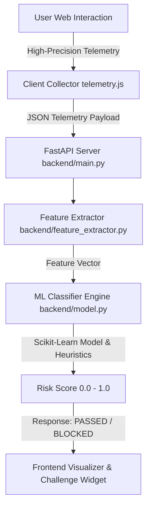

# Behavioral CAPTCHA & Biometric Bot Detection Engine

Welcome to the **Behavioral CAPTCHA** tryout playground. This project explores real-time bot detection using **behavioral biometrics** (mouse dynamics, velocity/acceleration profiles, curvature, jerk analysis, and keystroke dynamics).

---

## 1. Core Biometric Metrics & Feature Extraction

Traditional CAPTCHAs rely on visual challenges (e.g. identifying traffic lights) which modern AI models can easily bypass. Behavioral CAPTCHA passively analyzes *how* a user interacts with the page while moving towards or completing a simple action (such as clicking a checkbox or dragging a slider).

### Collected Raw Data Points
Each event sample $e_i$ recorded by the telemetry collector contains:
$$e_i = (x_i, y_i, t_i, \text{type})$$
where:
- $x_i, y_i$: Screen/Viewport coordinates in pixels
- $t_i$: High-precision timestamp from `performance.now()` in milliseconds
- $\text{type}$: Event type (`mousemove`, `mousedown`, `mouseup`, `keydown`, `keyup`)

---

## 2. Derived Feature Vector

From a sequence of samples $E = [e_1, e_2, \dots, e_N]$, we compute the following physical and statistical metrics:

| Feature Symbol | Feature Name | Formula / Definition | Human Signature | Bot Signature |
| :--- | :--- | :--- | :--- | :--- |
| $S_{\text{ratio}}$ | **Straightness Index** | $D_{\text{Euclidean}} / L_{\text{Total Path}}$ | $0.60 - 0.92$ (Curved/Sub-goals) | $0.98 - 1.00$ (Perfect straight line) |
| $\bar{v}, \sigma_v$ | **Velocity Mean & Std** | $v_i = \frac{\Delta d_i}{\Delta t_i}$ | Variable velocity profile (S-curve acceleration) | Uniform velocity ($\sigma_v \approx 0$) |
| $\bar{a}, \sigma_a$ | **Acceleration Mean & Std**| $a_i = \frac{\Delta v_i}{\Delta t_i}$ | Smooth increase -> decrease | Infinite spikes or zero |
| $\bar{j}$ | **Jerk Rate** | $j_i = \frac{\Delta a_i}{\Delta t_i}$ | Moderate continuous derivative | Extreme instantaneous jumps |
| $\bar{\kappa}$ | **Curvature & Angle Change**| $\theta_i = \text{atan2}(y_i - y_{i-1}, x_i - x_{i-1})$ | Continuous micro-corrections ($\sigma_\theta > 0$) | Zero angular variance or synthetic noisy jumps |
| $T_{\text{idle}}$ | **Stationary / Pause Ratio**| $t_{\text{idle}} / t_{\text{total}}$ | Micro pauses before deceleration ($10\% - 30\%$) | $0\%$ pause or fixed delay |
| $D_{\text{click}}$ | **Click Dwell Time** | $t_{\text{mouseup}} - t_{\text{mousedown}}$ | $60\text{ms} - 180\text{ms}$ | $< 5\text{ms}$ or static fixed value |

---

## 3. Human vs. Bot Behavioral Models

```
                                MOUSE TRAJECTORY PATTERNS
                                
         Human Trajectory                             Automated Bot Trajectory
    (Sub-movements & Natural Jitter)                  (Linear / Bezier / Direct)
  
      *---------\                                  *=============================>
     /           \____                            (Perfect straight line or exact
    /                 \____>                       mathematical Bezier curve)
   *                       *
 (Curved, micro-tremors, variable speed)         (Constant velocity, 0 jitter)
```

### Bot Types Simulated in Demo:
1. **Linear Bot**: Moves directly in a straight line with linear interpolation ($S_{\text{ratio}} = 1.0$).
2. **Simple Bezier Bot**: Moves along a cubic Bezier curve with uniform steps (smooth curve, but zero micro-tremor).
3. **Randomized Jitter Bot**: Straight line with artificial uniform random noise (lacks organic physiological frequency distribution).
4. **Teleport Bot**: Displaces instantly across large coordinate jumps without intermediate trajectory points.

---

## 4. Detection Architecture Overview



---

## 5. Experiment & Trial Guide

1. **Environment Setup**:
   - Python virtual environment `.venv` with `fastapi`, `uvicorn`, `scikit-learn`, `numpy`, `pandas`.
2. **Running the System**:
   - Start Backend: `python -m backend.main` or `uvicorn backend.main:app --reload`
   - Open Web Interface: Open `frontend/index.html` in browser.
3. **Interactive Testing**:
   - Move mouse naturally to click the "Verify Human" button. Observe the real-time velocity graph, straightness ratio, and green PASS score.
   - Click **"Simulate Linear Bot"** or **"Simulate Bezier Bot"** to feed synthetic trajectories into the engine. Observe immediate bot detection and score drop!
